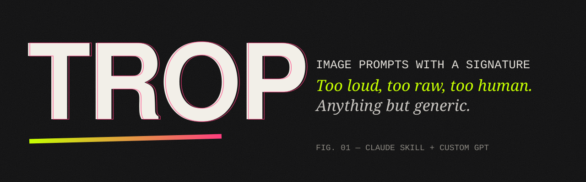
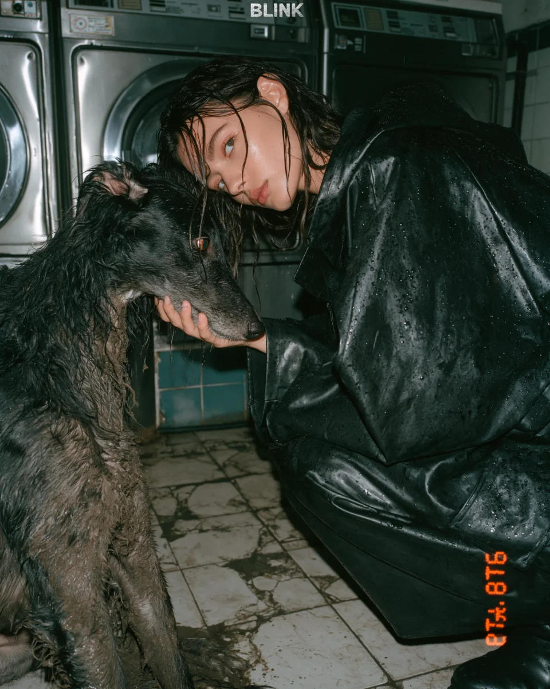
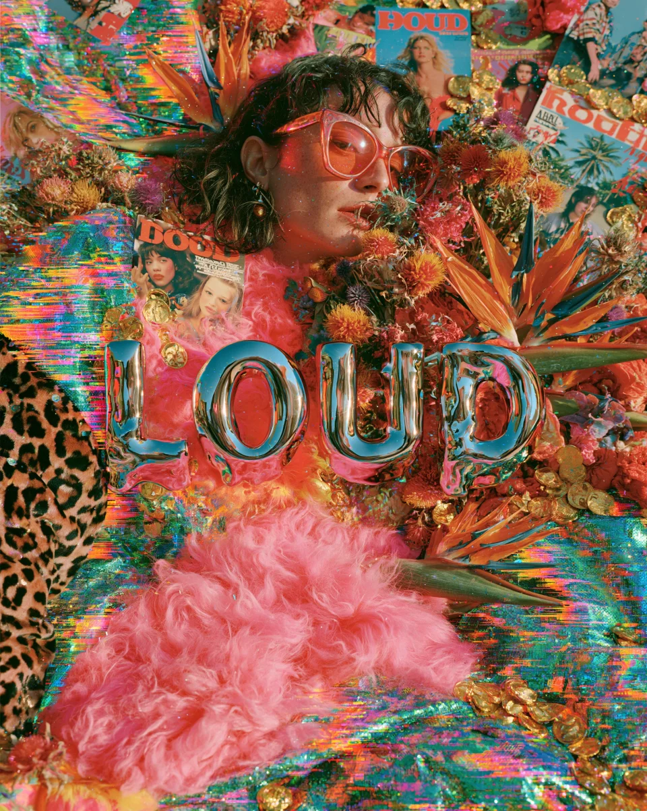
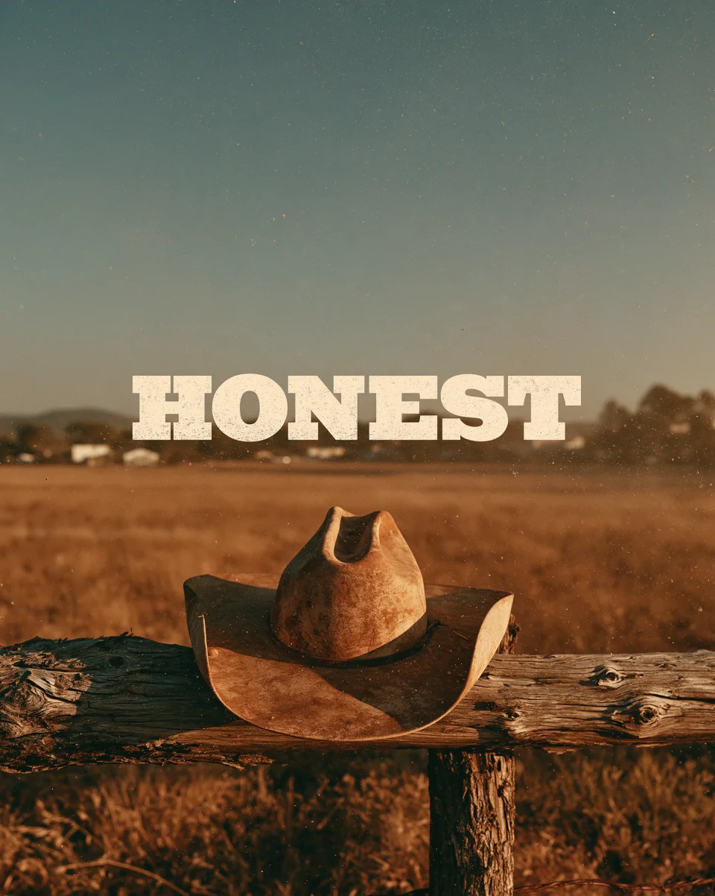

<p align="center"></p>

<p align="center">
  <b>A creative DNA for AI image prompts.</b><br>
  Not a prompt library — a way of thinking, building and writing images.<br>
  Available as a <b>Claude Skill</b> and a <b>ChatGPT Custom GPT</b>.
</p>

<p align="center">
  
  
  
  
</p>

---

## Visual results

<a href="assets/results/blink.webp"></a> <a href="assets/results/loud.webp"></a> <a href="assets/results/honest.webp"></a>

[Explore all ten images by Jérémy Gross](examples/results.md)

## Why TROP

*Trop* is French for **too much**. Too loud, too raw, too human.

Most AI images look the same: smooth, glossy, centered, soulless. The prompts behind them look the same too: `beautiful, stunning, 8k, masterpiece`.

TROP comes from a 2026 design-trend report written by an art director. Instead of handing you those prompts to copy, it extracts their **DNA** — the stance, the tension, the materials, the light, the typography, the imperfections, the closing intent — and teaches an AI to **create new prompts with the same signature**, for any brief.

> You ask for a coffee-brand visual. You don't get a cup on a table.
> You get a chipped enamel mug in an all-night diner at 4 a.m., a tungsten cone of light, the word **"AWAKE"** rising through the steam, 400-ISO grain — and a last line about warming your hands before you read a word.

## Generic vs. TROP

| Generic | TROP |
|---|---|
| `A beautiful cup of coffee on a table, cozy atmosphere, warm lighting, 8k, ultra detailed, masterpiece.` | *A slow, smoke-heavy editorial photograph built to be smelled before it is seen. A chipped enamel mug, still steaming, sits on the scarred steel counter of an all-night roadside diner at 4 a.m. […] the word "AWAKE" is set in a tall, condensed slab serif, cream-colored and slightly blurred as if seen through the steam. […] It is a quiet ritual, not a product shot.* `--ar 4:5 --v 7` |

Full prompts: [`examples/gallery.md`](examples/gallery.md)

## The DNA in 9 beats

Every TROP prompt is **one dense paragraph** (110–160 words) and a **design thesis disguised as a description**.

```
1. FRAME        charged adjectives + medium + stance      "A raw, high-impact editorial photograph…"
2. HERO         one subject, defined by material          a glossy vinyl coat, a chipped enamel mug
3. WORLD        a textured place with history             stained concrete, peeling wallpaper
4. LIGHT        a source that composes                    "…leaving a natural void for typography"
5. THE WORD     a 1–3 word manifesto, quoted, UPPERCASE   "AWAKE" in a condensed slab serif
6. PALETTE      colors named like matter                  oxblood, tobacco gold, molten orange
7. FINGERPRINT  the trace of a real process               grain, light leaks, halftone, red-eye
8. THE WHY      what it does to a human                   "…before a single word is read."
9. FORMAT       ratio by intent + model params            --ar 4:5 --v 7
```

Plus the signature moves: paradox pairs (*a whisper, not a shout*), scare quotes (*the design has "teeth"*), definition by negation (*anti-studio*), era references instead of artist names.

## 13 trends — and the method to invent more

| Photographic | Design |
|---|---|
| Direct Flash · Maximalism · Sensory Storytelling · Distorted Wide Angle · Grunge · Surrealism · Americana | Scrapbook/Scanner · Cyber Goth · Future Medieval · Skate/Surf Shop · Scribbles · Index/Catalog |

Each trend is a **lever sheet** (what it refuses, light, materials, type, fingerprints, ratios) — see [`trend-lexicon.md`](claude-skill/trop-image-prompts/references/trend-lexicon.md). The skill blends them (*Americana × Grunge*) or **invents new ones** (*Tender Concrete*, *Cold Archive*…).

---

## Install

### Claude (claude.ai / desktop)
1. Download [`dist/trop-image-prompts.zip`](https://github.com/absolument-ai/trop/raw/refs/heads/main/dist/trop-image-prompts.zip) (or zip the folder [`claude-skill/trop-image-prompts`](claude-skill/trop-image-prompts)).
2. In Claude, open the **Skills** section of your settings and **upload** the zip. Make sure Skills are enabled for your account.
3. Ask for any image: *"a poster for a jazz night in a laundromat"*. The skill triggers on its own.

### Claude Code
```bash
git clone https://github.com/absolument-ai/trop.git
mkdir -p ~/.claude/skills
cp -r trop/claude-skill/trop-image-prompts ~/.claude/skills/
```

### ChatGPT (Custom GPT)
Follow [`chatgpt-gpt/SETUP.md`](chatgpt-gpt/SETUP.md): paste [`instructions.md`](chatgpt-gpt/instructions.md), upload the two files from [`knowledge/`](chatgpt-gpt/knowledge), enable Image Generation. Done in 3 minutes.

### Any other LLM
Paste [`chatgpt-gpt/instructions.md`](chatgpt-gpt/instructions.md) as a system prompt and attach [`trop-style-dna.md`](chatgpt-gpt/knowledge/trop-style-dna.md).

## How to use

| Say | You get |
|---|---|
| `a key visual for a vegan butcher` | one TROP prompt + a one-line direction |
| `3 directions for a perfume launch` | three prompts with truly different stances |
| `a series of 4 for an Instagram campaign` | a consistent family: same stance & palette, new heroes and words |
| `remix this prompt: …` | your subject, injected with the DNA |
| `invent a new trend for a bakery` | a named trend, its refusal, its levers, and a prompt |
| `ChatGPT version` / `Midjourney version` | the same prompt adapted to the model |
| `start frame for Kling` | the still + a `Motion:` line |

## Repository

```
trop/
├── claude-skill/trop-image-prompts/
│   ├── SKILL.md                     ← the skill (mindset, anatomy, method, rules)
│   └── references/
│       ├── style-dna.md             ← annotated dissections, dials, vocabulary families
│       ├── trend-lexicon.md         ← 13 lever sheets + how to invent a trend
│       ├── model-adapters.md        ← Midjourney, GPT Image, Gemini, Flux, Ideogram, video
│       └── calibration-corpus.md    ← the original prompts (calibration only)
├── chatgpt-gpt/
│   ├── instructions.md              ← Custom GPT instructions (< 8,000 chars)
│   ├── knowledge/                   ← files to upload to the GPT
│   └── SETUP.md
├── examples/gallery.md              ← 6 new prompts written with the method
├── dist/trop-image-prompts.zip      ← ready-to-upload Claude skill
└── assets/banner.svg
```

## Principles

- **The flavor travels, the content never repeats.** The original prompts are a tuning fork, not a template.
- **Human first, digital second.** Every image carries a trace of the real world.
- **No filler words, no named artists, no copyrighted characters.** Describe eras, processes and materials instead.

## Contributing

New trends, model adapters and gallery entries are welcome — see [`CONTRIBUTING.md`](CONTRIBUTING.md).

## Credits

Created by **Jérémy Gross** — AI filmmaker & creative director, founder of BrainShift AI, MotionDream and Veez AI.
Original prompts from his *Design Trend Report 2026*.

## License

[MIT](LICENSE) — free to use, modify and share, including commercially. Keep the credit.
